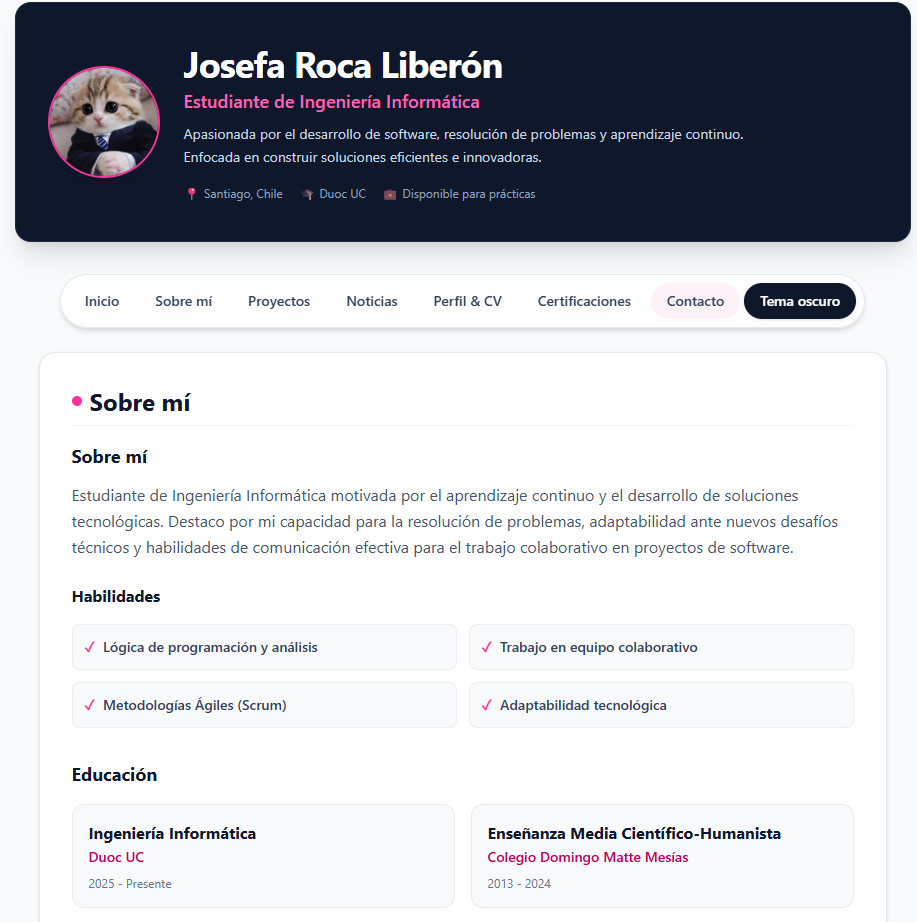
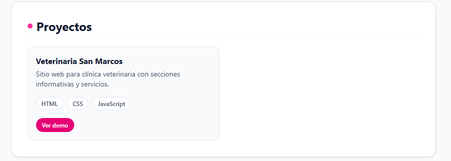
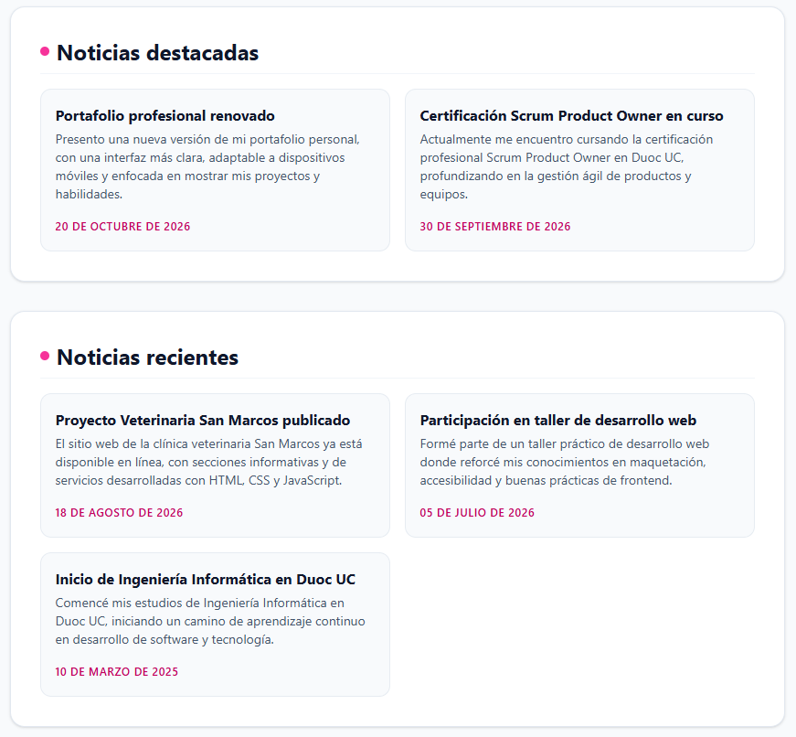

# Portafolio personal · Josefa Roca Liberón

Portafolio profesional desarrollado con React, TypeScript y Vite. El contenido se carga desde archivos JSON, incluye navegación entre secciones, vista de contacto y una suite de pruebas con Karma + Jasmine.

- **Demo:** [https://jocfapaz.github.io/](https://jocfapaz.github.io/)
- **Repositorio:** [https://github.com/jocfapaz/jocfapaz.github.io](https://github.com/jocfapaz/jocfapaz.github.io)

> La demo se publica automáticamente con GitHub Actions. En **Settings → Pages**, la fuente debe estar configurada como **GitHub Actions**.

## Capturas de pantalla

### Página principal



### Proyectos y noticias

| Proyectos | Noticias destacadas |
| --- | --- |
|  |  |

### Contacto y vista móvil

| Contacto | Móvil |
| --- | --- |
|  |  |

## Características

- Contenido centralizado en JSON: perfil, educación, proyectos, certificaciones, contacto y noticias.
- Carga de datos mediante `usePortfolioData` y loaders asíncronos.
- Navegación con React Router: `/` y `/contact`.
- Secciones de inicio con anclas: `#sobre-mi`, `#proyectos`, `#noticias-destacadas`, `#noticias-recientes`, `#cv`, `#certificaciones` y `#contacto`.
- Noticias separadas en **Destacadas** y **Recientes**, ordenadas por fecha.
- Diseño responsive con Tailwind CSS.
- Modo claro/oscuro persistente y navegación accesible entre rutas y anclas.
- Enlace de salto al contenido, foco visible y soporte para `prefers-reduced-motion`.
- Fallback `404.html` para conservar las rutas SPA al publicar en GitHub Pages.
- Imagen de perfil optimizada y carga diferida de imágenes de proyectos.
- Pruebas unitarias, de integración y de componentes con Karma + Jasmine.
- Cobertura de código con `karma-coverage` e `istanbul`.

## Tecnologías

- React 19
- TypeScript
- Vite 8
- React Router
- Tailwind CSS 4
- Karma
- Jasmine
- Testing Library
- ESLint

## Accesibilidad

- Documento con `lang="es"`, título descriptivo y metadatos de autor/descripción.
- Enlace “Saltar al contenido”, `<main id="contenido">` y navegación con `aria-label`.
- Estado activo de las rutas con `NavLink` y `aria-current`.
- Selector de tema con `aria-pressed`, persistencia en `localStorage` y respeto por `prefers-color-scheme`.
- Estilos de foco visibles y reducción de animaciones con `prefers-reduced-motion`.
- Contrastes corregidos en etiquetas, enlaces, fechas y estados.
- Estados de carga y error anunciados con `role="status"` y `role="alert"`.
- Emojis e iconos decorativos ocultos para lectores de pantalla.

## Rendimiento

- Imagen de perfil optimizada a 256×256 px y ~12 KB.
- Imágenes de proyectos con `loading="lazy"` y `decoding="async"`.
- Eliminación de recursos sin usar (`hero.png`, `react.svg`, `vite.svg`, `icons.svg`).
- Build de producción minificado con Vite.

## Requisitos

- Node.js 20.19+ (recomendado 22 o 24)
- npm
- Google Chrome y/o Microsoft Edge para ejecutar las pruebas

## Instalación

```bash
git clone https://github.com/jocfapaz/jocfapaz.github.io.git
cd jocfapaz.github.io
npm install
```

## Ejecución

Inicia el servidor de desarrollo:

```bash
npm run dev
```

Vite mostrará la URL local, normalmente `http://localhost:5173`.

Para generar la versión de producción:

```bash
npm run build
```

Para previsualizar el resultado de producción:

```bash
npm run preview
```

## Despliegue en GitHub Pages

El despliegue se realiza con el workflow `.github/workflows/deploy.yml`:

1. Cada push a `main` ejecuta lint, typecheck, pruebas y build.
2. El contenido de `dist/` se publica como artefacto de GitHub Pages.
3. `public/404.html` redirige las rutas SPA a `index.html` para que `/contact` funcione al recargar.

Configuración necesaria en GitHub:

- Ir a **Settings → Pages**.
- En **Build and deployment → Source**, seleccionar **GitHub Actions**.
- Ejecutar el workflow manualmente con **Actions → Deploy to GitHub Pages → Run workflow** si es la primera publicación.

La URL esperada es [https://jocfapaz.github.io/](https://jocfapaz.github.io/).

## Pruebas

| Comando | Descripción |
| --- | --- |
| `npm test` | Ejecuta todas las pruebas una vez en Chrome headless. |
| `npm run test:chrome` | Ejecuta las pruebas en Chrome headless. |
| `npm run test:edge` | Ejecuta las pruebas en Microsoft Edge headless. |
| `npm run test:all` | Ejecuta la suite en Chrome y Edge. |
| `npm run test:watch` | Ejecuta las pruebas en modo watch. |
| `npm run typecheck:test` | Verifica los tipos de `src` y `tests`. |
| `npm run lint` | Ejecuta ESLint. |
| `npm run test:coverage` | Ejecuta las pruebas y genera el informe de cobertura. |

Ejemplo de ejecución completa:

```bash
npm run lint
npm run typecheck:test
npm run test:all
npm run build
```

### Cobertura

El informe se genera en:

```text
coverage/index.html
```

Los umbrales configurados son:

- Sentencias: 80%
- Ramas: 70%
- Funciones: 80%
- Líneas: 80%

Si Chrome o Edge no se detectan automáticamente, define la ruta del ejecutable:

```powershell
$env:CHROME_BIN = "C:\ruta\a\chrome.exe"
$env:EDGE_BIN = "C:\ruta\a\msedge.exe"
```

En Windows, `karma.edge.cjs` busca Edge en las rutas habituales de instalación.

## Estructura del proyecto

```text
.
├── .github/
│   └── workflows/
│       └── deploy.yml          # Publicación automática en GitHub Pages
├── docs/
│   ├── legacy/                 # Versión anterior del sitio
│   └── screenshots/            # Capturas usadas en este README
├── public/
│   ├── 404.html                # Fallback para rutas SPA
│   └── favicon.svg
├── src/
│   ├── assets/                 # Imágenes y recursos
│   ├── components/
│   │   ├── about/              # Sobre mí y educación
│   │   ├── certifications/     # Certificaciones
│   │   ├── contact/            # Información de contacto
│   │   ├── news/               # Noticias destacadas y recientes
│   │   ├── projects/           # Proyectos
│   │   └── ui/                 # Componentes reutilizables
│   ├── core/                   # Root, Header, Navegación y Footer
│   ├── data/                   # JSON, tipos y selectores
│   ├── hooks/                  # usePortfolioData y useTheme
│   ├── pages/                  # Home y Contact
│   ├── services/               # Loaders del portafolio
│   ├── index.css
│   └── main.tsx
├── tests/
│   ├── components/
│   ├── core/
│   ├── data/
│   ├── fixtures/
│   ├── hooks/
│   ├── integration/
│   ├── pages/
│   ├── services/
│   └── setup.ts
├── eslint.config.js
├── karma.conf.cjs
├── karma.coverage.cjs
├── karma.edge.cjs
├── package.json
└── vite.config.ts
```

## Cómo actualizar el contenido

Todo el contenido del portafolio vive en `src/data/`.

### Agregar un proyecto

Edita `src/data/projects.json`:

```json
[
  {
    "id": "mi-nuevo-proyecto",
    "title": "Mi nuevo proyecto",
    "description": "Descripción breve del proyecto.",
    "tech": ["React", "TypeScript"],
    "image": "/mi-proyecto.png",
    "demoUrl": "https://example.com/demo",
    "repoUrl": "https://github.com/usuario/mi-proyecto"
  }
]
```

Los campos `image`, `demoUrl` y `repoUrl` son opcionales.

### Agregar una noticia

Edita `src/data/news.json`:

```json
[
  {
    "id": "nueva-noticia",
    "title": "Nueva noticia",
    "date": "2026-10-29",
    "content": "Contenido de la noticia.",
    "featured": true
  }
]
```

- `featured: true` muestra la noticia en **Destacadas**.
- `featured: false` o ausente la muestra en **Recientes**.
- Las noticias se ordenan por fecha descendente.

### Actualizar perfil y contacto

- Perfil: `src/data/profile.json`
- Educación: `src/data/education.json`
- Certificaciones: `src/data/certifications.json`
- Contacto: `src/data/contact.json`

Los tipos esperados están definidos en `src/data/types.ts`.

## Ejemplos de uso

### Navegar por el portafolio

- Inicio: `http://localhost:5173/`
- Contacto: `http://localhost:5173/contact`
- Proyectos: `http://localhost:5173/#proyectos`
- Noticias: `http://localhost:5173/#noticias-destacadas`

### Ejecutar una prueba específica

Karma carga todos los archivos `tests/**/*.spec.tsx`. Para trabajar en una prueba concreta, usa el modo watch:

```bash
npm run test:watch
```

### Verificar la cobertura antes de publicar

```bash
npm run test:coverage
```

Luego abre `coverage/index.html` en el navegador.

## Autor

Josefa Roca Liberón

- GitHub: [@jocfapaz](https://github.com/jocfapaz)
- Portafolio: [https://jocfapaz.github.io/](https://jocfapaz.github.io/)
